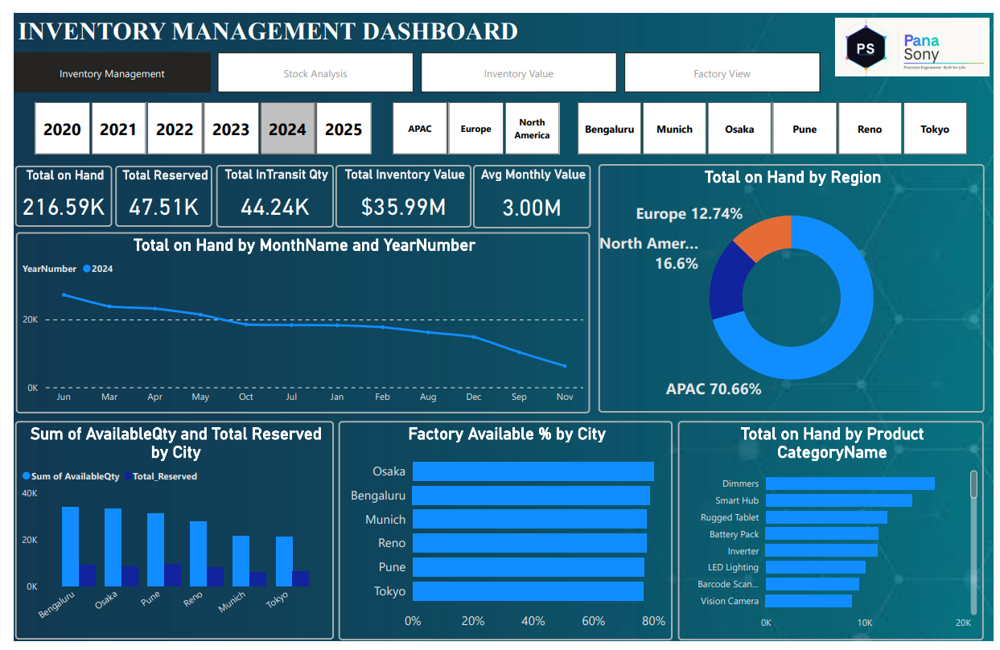
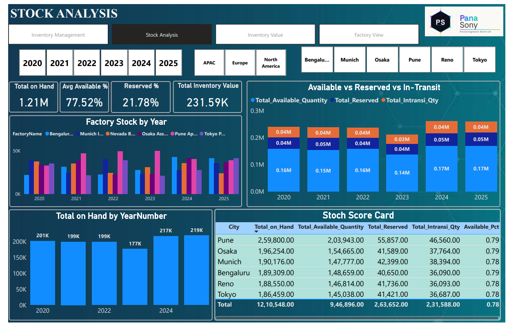
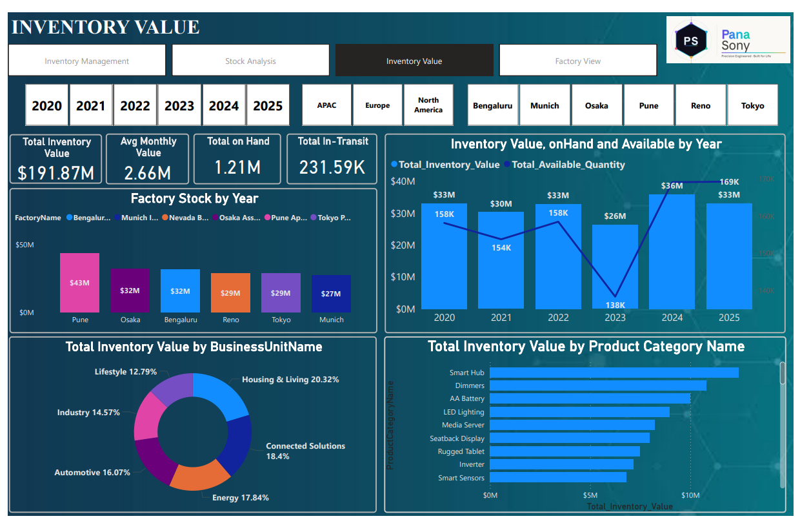
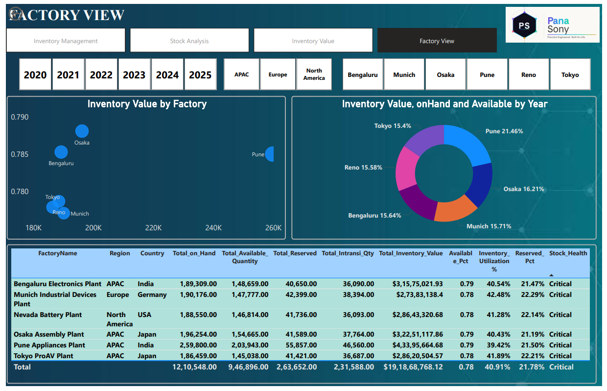

# Inventory Management Dashboard | SQL & Power BI

An inventory analytics project built with **SQL** and **Power BI** to monitor stock levels, available and reserved quantities, in-transit inventory, inventory value, and factory-level performance.

## Dashboard Screenshots

### 1. Inventory Management Dashboard


This page summarizes on-hand stock, reserved stock, in-transit quantity, inventory value, and monthly value. It also includes regional stock distribution, city availability, and product-category stock.

### 2. Stock Analysis


This page compares factory stock across years, available vs. reserved vs. in-transit quantities, yearly on-hand totals, and a stock scorecard by city.

### 3. Inventory Value


This page explores inventory value by year, factory, business unit, and product category.

### 4. Factory View


This page presents factory-level inventory quantities and value, availability, utilization, reserved percentage, and stock-health status.

## Key Metrics Shown in the Screenshots

The values below are transcribed from the supplied dashboard screenshots and have not been independently recalculated.

| Dashboard page | Metric | Displayed value |
|---|---|---:|
| Inventory Management | Total on Hand | 216.59K |
| Inventory Management | Total Reserved | 47.51K |
| Inventory Management | Total In-Transit Qty | 44.24K |
| Inventory Management | Total Inventory Value | $35.99M |
| Inventory Management | Average Monthly Value | 3.00M |
| Stock Analysis | Total on Hand | 1.21M |
| Stock Analysis | Average Available % | 77.52% |
| Stock Analysis | Reserved % | 21.78% |
| Inventory Value | Total Inventory Value | $191.87M |

**Data note:** Different pages display different totals (for example, $35.99M on the Inventory Management page and $191.87M on the Inventory Value page). The figures are presented as shown in the supplied screenshots and have not been reconciled.

## Tools & Technologies

- **SQL / MySQL scripts** — database tables, date and product dimensions, inventory fact data, and a Power BI summary view.
- **Power BI Desktop** — report pages, KPI cards, slicers, charts, and tables.
- **Data visualization** — line chart, bar/column charts, donut charts, and scorecard-style tables.

## Repository Structure

```text
Inventory_Management_GitHub_Project/
├── README.md
├── PROJECT_OVERVIEW.txt
├── powerbi/
│   └── PROJECT_INVENTORY_MANAGEMENT.pbix
├── sql/
│   ├── SQL_inventory_management_original.zip
│   └── extracted_sql_files/
│       └── SQL inventory management/
│           ├── DimDate_MySQL.sql
│           ├── DimProduct.sql
│           ├── FactInventory.sql
│           ├── inventory management.sql
│           └── view_PowerBI_FactInventorySummary.sql
├── docs/
│   └── PROJECT_INVENTORY_MANAGEMENT.pdf
└── screenshots/
    ├── Inventory_Management_Dashboard.png
    ├── Stock_Analysis.png
    ├── Inventory_Value.png
    └── Factory_View.png
```

## How to Use

1. Download or clone this repository.
2. Open `powerbi/PROJECT_INVENTORY_MANAGEMENT.pbix` in Power BI Desktop.
3. Review the SQL scripts in `sql/extracted_sql_files/SQL inventory management/` or the original ZIP.
4. If Power BI requests a data source or credentials, configure the connection for your local environment.
5. Use the screenshots in `screenshots/` as previews of the report pages.

## SQL Files Included

- `DimDate_MySQL.sql`
- `DimProduct.sql`
- `FactInventory.sql`
- `inventory management.sql`
- `view_PowerBI_FactInventorySummary.sql`

These are the SQL files provided with the project. Review their database names and table references before running them in your own environment.

## Suggested Future Enhancements

- Add low-stock and reorder-point alerts.
- Track inventory turnover and days of inventory on hand.
- Analyze supplier lead times and stockout risk.
- Add drill-through pages for individual factories and products.
- Configure scheduled refresh and row-level security where supported.

## Notes

- The `.pbix`, PDF, SQL archive, and screenshots were supplied as project assets.
- No separate raw CSV dataset was supplied with this project package.
- Verify data-source paths, credentials, and any sensitive information before publishing the `.pbix` file publicly.

---
**Project:** Inventory Management Dashboard  
**Focus:** SQL, inventory KPIs, stock analysis, inventory valuation, factory reporting, and Power BI
